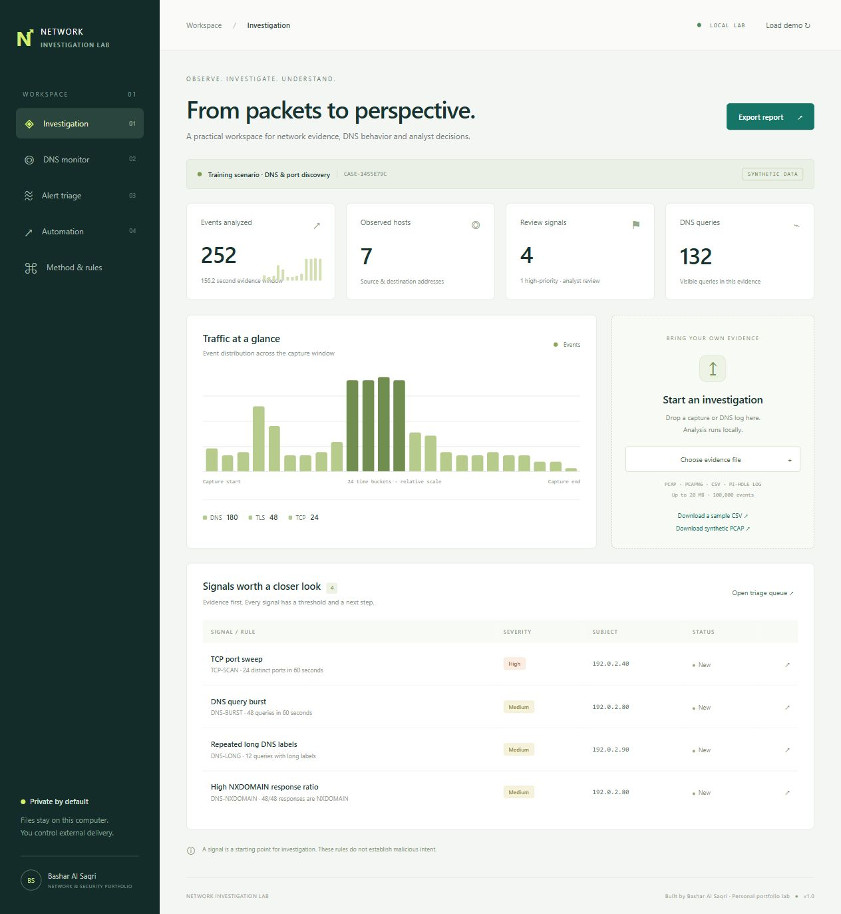
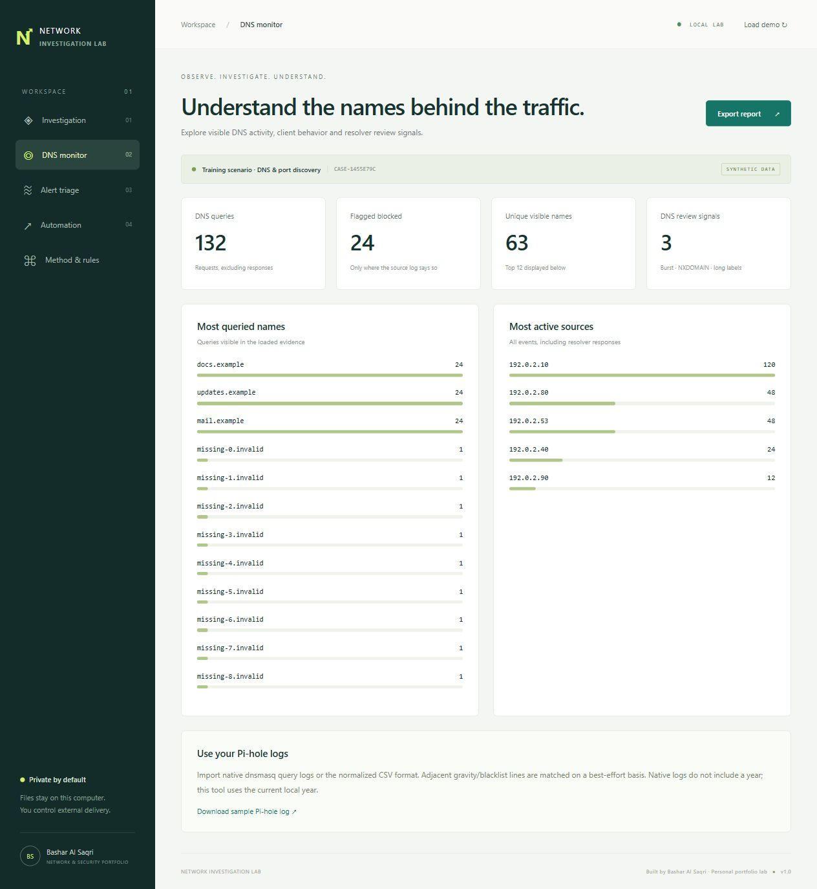
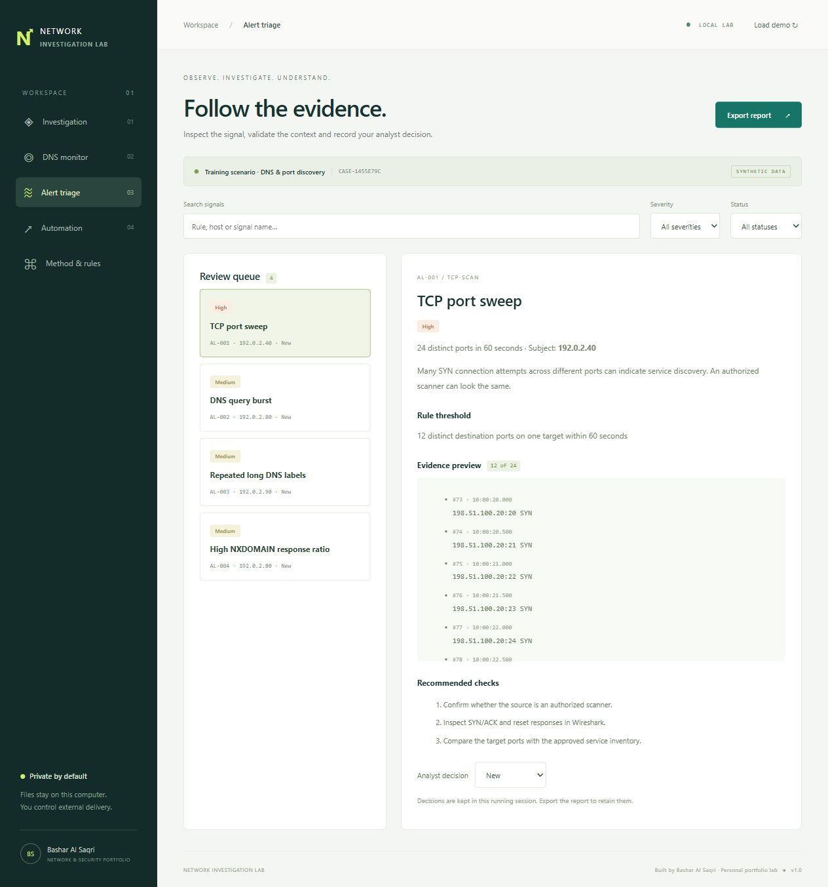
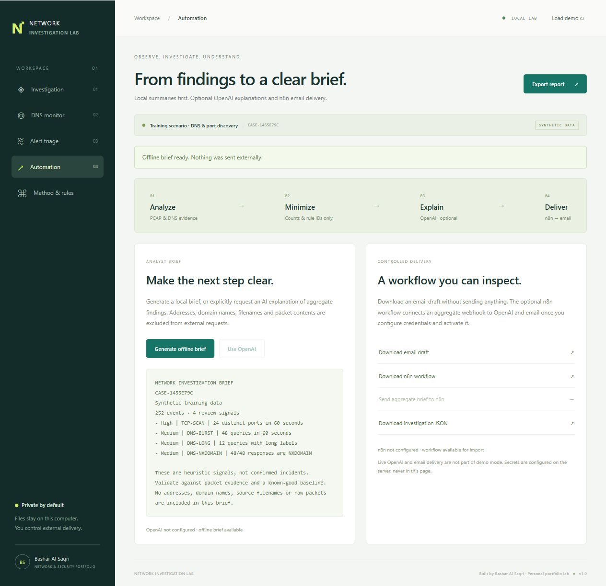

# Portfolio review

## One suite, three connected modules

- Network Threat Investigation Lab: local packet-file analysis and explainable signals.
- DNS Security Monitor: DNS query behavior and Pi-hole log exploration.
- Security Alert Triage: analyst decisions, report export, and optional OpenAI/n8n/email adapters.

## Status

Implemented and locally verified: analysis engine, CSV/log/PCAP input, dashboard, DNS views, filtering, evidence details, analyst decisions, HTML/JSON/EML output, offline brief.

Prepared with mocked adapter tests: direct OpenAI call and n8n webhook delivery.

Not live-verified: paid OpenAI responses, importing/executing inside an actual n8n instance, SMTP delivery. These need the owner's credentials, chosen model and recipient.

This is a new personal lab using synthetic inputs. It does not claim to be a recovered company deployment.

## Screenshots

## Suggested demonstration

Open the synthetic case, identify the 24-port SYN sweep, inspect its evidence and false-positive explanation, record an analyst decision, review DNS behavior, then export a report and generate an offline brief.

Explain why a signal needs validation. Show what data is excluded from external integration payloads. Do not describe heuristics as confirmed attacks.

## Useful next development steps

Historical baselines; precise resolver log correlation; case persistence with explicit retention; additional labelled test captures; measured false-positive evaluation. No performance or detection-rate claims have been established.
