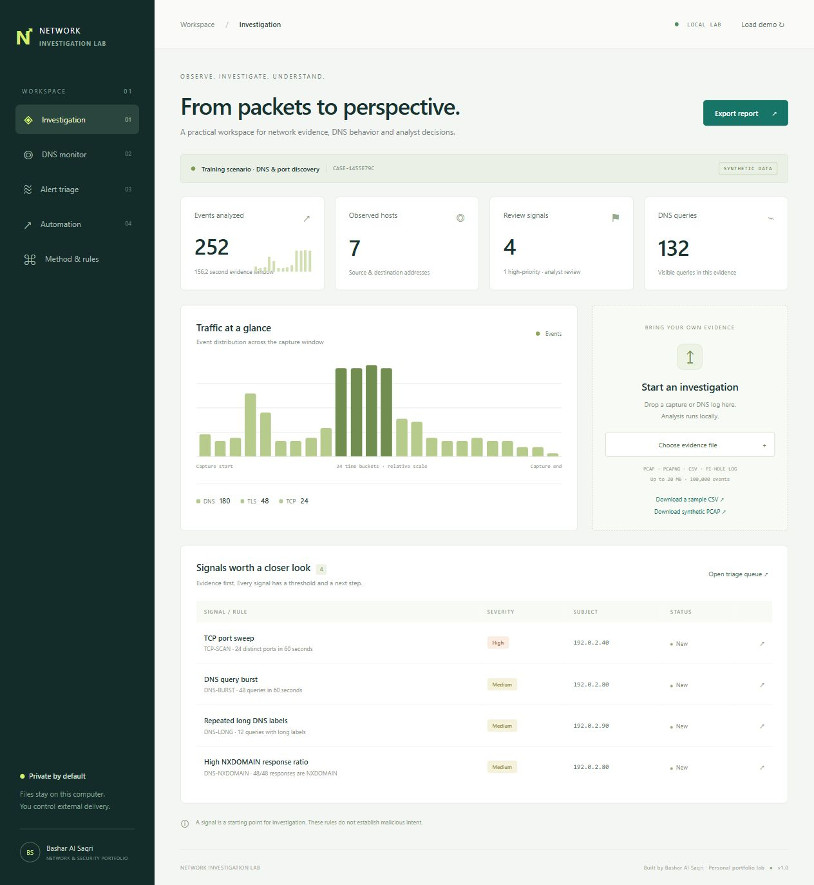

# Network Investigation Lab

A local defensive security workspace by **Bashar Al Saqri**. Three connected portfolio modules: packet investigation, DNS monitoring, and analyst alert triage with optional OpenAI/n8n/email integration.

This is a new personal lab implementation. It contains synthetic training data and newly written code, not recovered company configurations or a claim of a production deployment.

See [all four screens and the portfolio review](PORTFOLIO.md).

## Open the app

On this Windows computer, double-click **Open Network Lab.cmd**. It starts the server in the background and opens the browser. Reopening it reuses a running instance. Python 3.10+ is required; no pip packages are needed.

Manual launch:

    python app.py --port 8766

Open http://127.0.0.1:8766. The server binds only to the local loopback interface. Keep the server running while using the app. To stop a manual launch, press Ctrl+C in its terminal.

TShark (installed with Wireshark) is needed only for PCAP/PCAPNG. CSV, Pi-hole logs and the built-in scenario work without it. Detection supports Windows True/False and numeric TShark boolean output.

## What works

| Module | Functionality |
| --- | --- |
| Network Threat Investigation | PCAP/PCAPNG via TShark; normalized CSV; event timeline; protocol and host summaries; frame references |
| DNS Security Monitor | Native Pi-hole query logs and CSV; query and blocked counters; top names; source ranking; DNS heuristics |
| Security Alert Triage | Search and severity/status filters; evidence previews; explainable rules; analyst decisions; HTML/JSON reports |
| Automation | Offline brief; unsent EML draft; optional explicit OpenAI request; optional explicit delivery to n8n; inactive workflow template |

No live network capture, active scanning, automatic blocking or automatic message delivery occurs in demo mode.

## A two-minute demonstration

1. Open the lab. The built-in synthetic scenario contains **252 events and four rule signals**.
2. Open **Alert triage**, select TCP port sweep, and inspect the evidence and alternative explanations.
3. Change its decision to Investigating. Export HTML to retain that decision.
4. Open **DNS monitor** to inspect query distribution and source activity.
5. Open **Automation** and generate the offline brief. Download an unsent email draft.
6. Import samples/training-scenario.pcap to exercise actual TShark decoding, or samples/pihole.log for the DNS log parser.
7. Read **Method & rules** for thresholds and limitations.

## Detection rules

| Rule | Threshold | Important caveat |
| --- | --- | --- |
| TCP-SCAN | 12 distinct destination ports on one target in a sliding 60-second window | Authorized discovery tools can trigger it |
| DNS-BURST | 40 queries per source in a sliding 60-second window | Busy apps and retries can trigger it |
| DNS-NXDOMAIN | At least 20 responses per destination client; at least 65% NXDOMAIN | Failed names do not establish malware |
| DNS-LONG | At least eight queries containing a label of 45+ characters | Legitimate software also uses long names |

Rules are heuristic review signals. They do not establish malicious intent. Windows are evaluated with a sliding counter rather than repeatedly copying all events. The app includes evidence previews of up to 12 events per signal.

## Data formats

CSV requires timestamp and src. Optional columns: dst, protocol, length, port, syn, domain, response, rcode, blocked.

- timestamp: Unix epoch seconds or ISO 8601. Use a timezone for ISO timestamps.
- syn: true/1 for initial TCP SYN attempts, not SYN/ACK.
- response: true/1 for DNS responses; src is the resolver and dst the client.
- rcode: numeric DNS result, 3 for NXDOMAIN.
- blocked: true/1 only when your source log establishes the block.
- A source needs visible DNS names for DNS rules to operate.

Pi-hole native log support is limited to dnsmasq query lines and adjacent gravity/blacklisted/regex block lines. The year is inferred from the current local year. Block attribution is best effort by most recent matching name; concurrent/repeated names may be ambiguous. Use normalized CSV for more precise attribution.

## Architecture

    Browser UI
        -> Loopback HTTP server (Python standard library)
            -> PCAP decoder (TShark, temporary file, then removed)
            -> CSV / Pi-hole parser
            -> Explainable rule engine
            -> In-memory cases and analyst decisions
            -> HTML / JSON / unsent email draft
            -> Optional aggregate-only OpenAI or n8n request

Cases are retained only in memory, up to 12 per running instance. Restarting the server clears cases and decisions. Export reports to keep them. Raw uploads are not retained; temporary PCAP files are removed after decoding. Explicit report exports can include private addresses, names and source filenames.

## Optional OpenAI and email setup

All integration features remain off until configured. Do not paste secrets into source files or the browser.

For a manual server launch, configure environment variables in your own terminal:

    OPENAI_API_KEY
    OPENAI_MODEL
    N8N_WEBHOOK_URL
    N8N_WEBHOOK_TOKEN

The app reads environment variables; it does not automatically load .env files. A credential-free .env.example documents the names. Restart the server after changing its environment.

The direct OpenAI adapter calls the Responses API with store=false and sends aggregate metrics and rule IDs/totals, not addresses, domains, source filenames or packet contents. AI output remains an interpretation requiring review. Availability and billing depend on your API account and selected model.

### n8n → OpenAI → email

Import integrations/n8n-workflow.json into your own n8n instance. It is inactive and contains no credentials.

1. In Aggregate Webhook, configure Header Auth with X-Lab-Webhook-Token and your own secret.
2. In OpenAI Brief, configure HTTP Header Auth with Authorization and Bearer YOUR_API_KEY inside n8n credentials.
3. Replace CONFIGURE_MODEL with a model available to your account.
4. Configure SMTP credentials, a sender and your own test recipient in Send Reviewed Brief.
5. Test with synthetic data and inspect the result before activating.
6. Set the lab N8N_WEBHOOK_URL to the actual production webhook and its matching token.
7. Use the app's explicit delivery button. The confirmation explains that a configured workflow may send an email.

The workflow validates and minimizes its incoming JSON again before calling OpenAI. Credentials and the recipient stay in your n8n instance. A successful webhook response proves acceptance only, not that email was delivered.

**Verification boundary:** the local engine, UI and API adapters were tested locally. Real paid OpenAI calls, import/execution inside a live n8n instance, and SMTP delivery were not performed because no live credentials or recipient were configured. Integration tests use mocks and a local HTTP server.

## Verify

    python -m unittest discover -s tests -v
    node --check static/app.js

Tests cover threshold boundaries, benign baseline, time windows, DNS response attribution, file validation, actual synthetic PCAP decoding when TShark is installed, privacy minimization, HTML escaping, local request protection and mocked integration behavior.

Regenerate fixtures:

    python build_samples.py

All demo addresses use documentation ranges and names under example/invalid. The fixture is generated locally; no real network traffic is needed. The normalized CSV's lengths are illustrative; actual PCAP frame lengths are decoded by TShark.

## Limits and security

- Personal local review tool, not a production IDS, SOC platform or forensic chain-of-custody system.
- Files are capped at 20 MB; PCAP decoding examines the first 100,000 packets and has a 45-second timeout. CSV/log input rejects more than 100,000 events.
- Protocol counts use the last decoded protocol layer, not a complete protocol hierarchy.
- Encrypted DNS/payloads may be unavailable. No TLS decryption is attempted.
- Initial SYN attempts are not confirmed successful connections.
- PCAP decoding uses the installed Wireshark parser. Only inspect captures you are authorized to handle.
- Host validation, a per-process request token and same-origin checks guard local write actions. No public binding is provided.
- No company files, old tokens, private VPN keys or screenshots are bundled.

## Official references

- [OpenAI text generation and Responses API](https://developers.openai.com/api/docs/guides/text)
- [n8n HTTP Request node](https://docs.n8n.io/integrations/builtin/core-nodes/n8n-nodes-base.httprequest/)
- [n8n Webhook node](https://docs.n8n.io/integrations/builtin/core-nodes/n8n-nodes-base.webhook/)

